# Hi, I'm Dhruv Upadhyay 👋

<picture>
  <source media="(prefers-color-scheme: dark)" srcset="./dark.svg">
  <source media="(prefers-color-scheme: light)" srcset="./light.svg">
  
</picture>

  <b>Cybersecurity Student · Web Security Developer · Malware Analysis · AI & Security Copilot Builder</b>

  🛡️ Threat Scoring &nbsp;·&nbsp; 🐍 Python &nbsp;·&nbsp; ⚡ Gemini API &nbsp;·&nbsp; ⚛️ React & Node.js
  &nbsp;·&nbsp; 🎨 Three.js / WebGL &nbsp;·&nbsp; 🗄️ MongoDB & PostgreSQL &nbsp;·&nbsp; 🐧 Linux

I build **open-source cybersecurity tools, AI-powered threat analysis copilots, interactive 3D web applications, and scalable full-stack platforms**.

My current engineering focus sits at the intersection of **cybersecurity, automated threat scoring, dynamic malware sandboxing, web application security, and client-side AI integration**.

---

## 🤖 What I Build

- 🛡️ **Cybersecurity Copilots & Security Tools** — Open-source threat detection, AI phishing analysis, and direct API integrations
- 🧪 **Malware Analysis & Threat Engines** — Sandboxing workflows, CAPEv2 module testing, and automated risk scoring
- ⚛️ **Full-Stack Security Applications** — Interactive web platforms built with Node.js, Express, React, and MongoDB
- 🎨 **3D Interactive Web Experiences** — WebGL, Three.js voxel wave visualizers, Framer Motion, and dynamic Vanta.js backgrounds
- ⚙️ **Developer Automation & Tooling** — Python virtual environment workflows, dynamic API routing, and deployment automation

---

## 🎓 Education & Background

### B.Tech in Computer Science Engineering (Specialization in Cybersecurity)
**Netaji Subhas University of Technology (NSUT), Delhi** | *4th Year Student (Class of 2027)*

- Specializing in **Information Security, System Defense, and Malware Analysis**
- Developed and deployed security-focused web tools and custom Python threat processing modules
- Built dynamic client/server architectures integrating Google Gemini, Groq, and OpenAI models

---

## 🧩 Featured Projects

### 🛡️ Phish-Guard — AI Cybersecurity Copilot
[Live Site](https://dhruvdev-codes.github.io/phish-guard) · [GitHub Repository](https://github.com/Dhruvdev-codes/phish-guard)

Open-source web security copilot offering real-time threat detection and phishing analysis using direct client-side Gemini API routing.

- Client-side bring-your-own-key dynamic API configuration
- Fallback resilience for offline threat assessment
- Interactive UI tailored for security auditing
- **JavaScript · Google Gemini API · Tailwind CSS · GitHub Pages**

### ✍️ SyncScribe — Web Application Platform
[Live Site](https://dhruvdev-codes.github.io/SyncScribe/)

Web application featuring client-side state synchronization, offline fallback handling, and single-page subpath routing.

- SPA routing optimizations for static hosting environments
- Client-side persistence and real-time state sync
- **React · JavaScript · Node.js · GitHub Pages**

### 🌐 Personal Portfolio & Visual Labs
[Live Site](https://dhruvdev-codes.github.io/portfolio)

Interactive developer portfolio featuring 3D voxel grid background animations, Framer Motion tilt effects, and dark spotlight cursor glow.

- High-performance 3D scene rendering and scroll-driven grid waves
- Dual off-white and dark spotlight aesthetic mode styling
- **Three.js · Vanta.js · Framer Motion · Tailwind CSS**

---

## 🛠️ Engineering Stack

### 🛡️ Cybersecurity & Analysis
`Malware Sandboxing` `CAPEv2` `Threat Scoring Engines` `Phishing Analysis` `Web Application Security` `Linux / Bash`

### 🤖 AI & API Integration
`Google Gemini API` `Groq API` `OpenAI API` `Client-side Routing` `AI Security Copilots`

### ⚛️ Frontend & 3D Web
`JavaScript` `React` `Three.js` `WebGL` `Framer Motion` `Vanta.js` `Tailwind CSS`

### ⚙️ Backend & Databases
`Python` `Node.js` `Express` `MongoDB Atlas` `PostgreSQL` `Upstash Redis`

### ☁️ Tools & Environments
`Git / GitHub` `VS Code` `VirtualBox` `Linux (Ubuntu)` `Poetry / Pyenv` `Vercel`

---

## 📊 GitHub Activity

  
  

 

  

---

## 📫 Connect With Me

  💼 <a href="https://github.com/Dhruvdev-codes">GitHub Profile</a> 
  🌐 <a href="https://dhruvdev-codes.github.io/portfolio">Portfolio Website</a> 
  🛡️ <a href="https://dhruvdev-codes.github.io/phish-guard">Phish-Guard Copilot</a> 
  📧 <a href="mailto:dhruvupadhyay708937@gmail.com">Email</a>

> **Analyze threats. Build securely. Scale with intent.**
